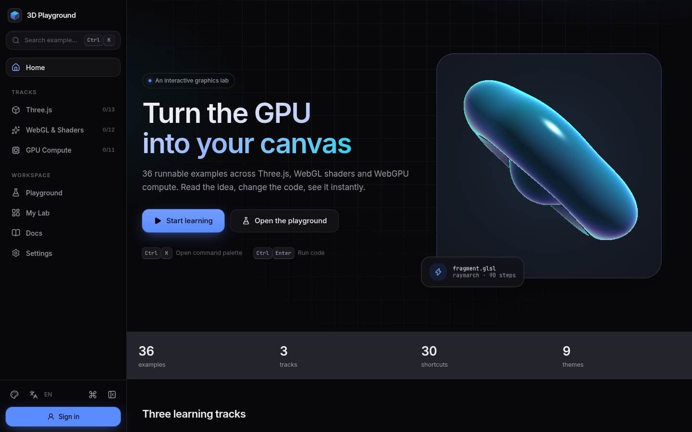
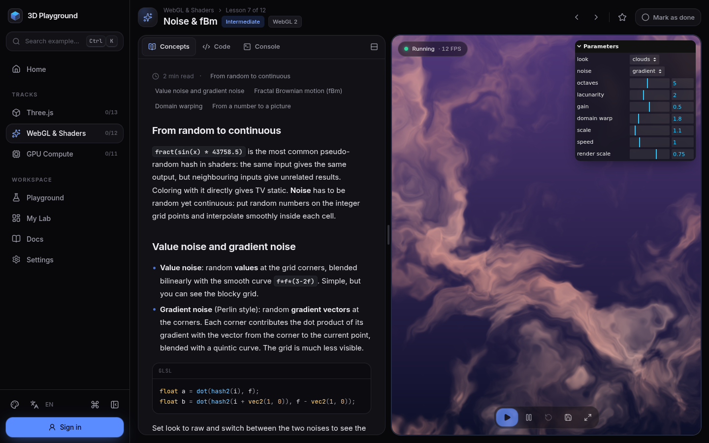
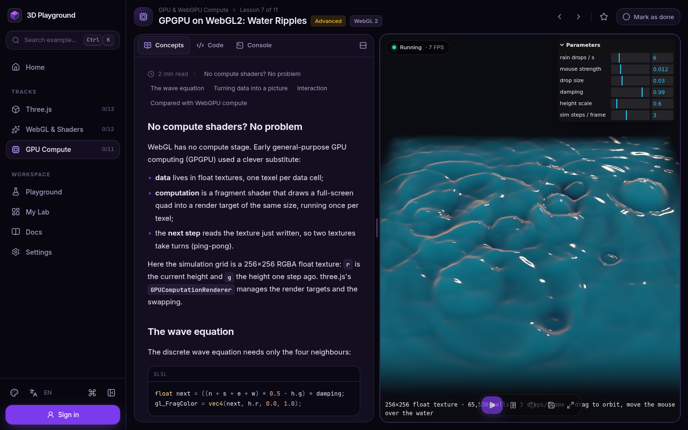
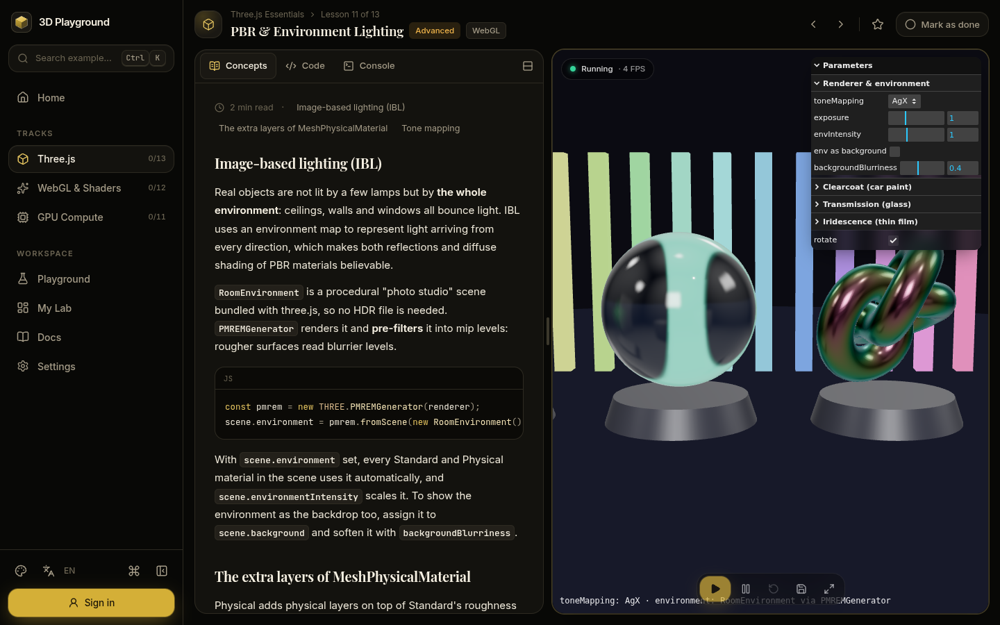
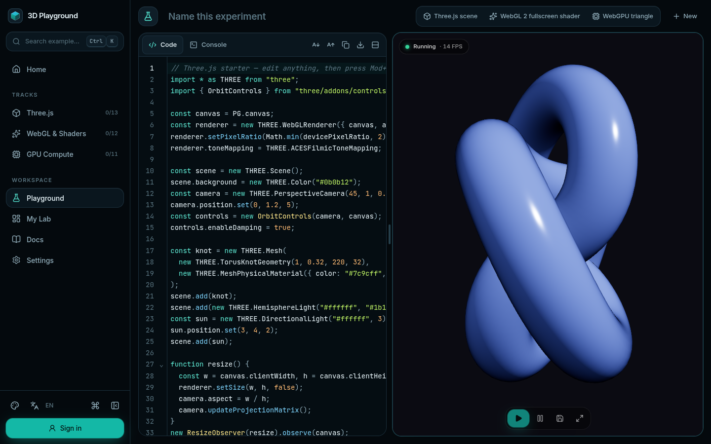
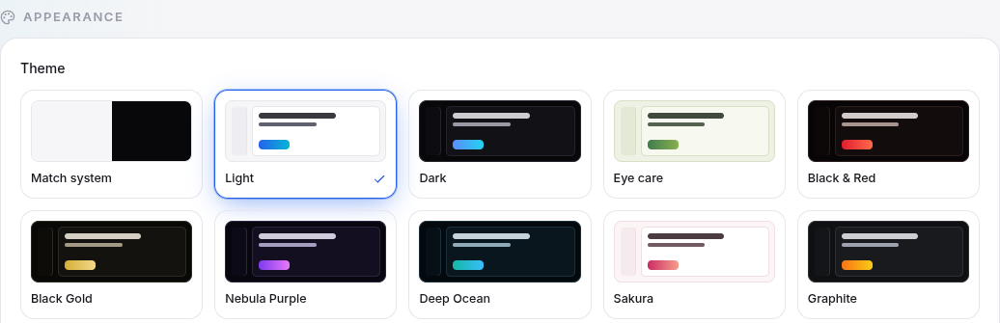
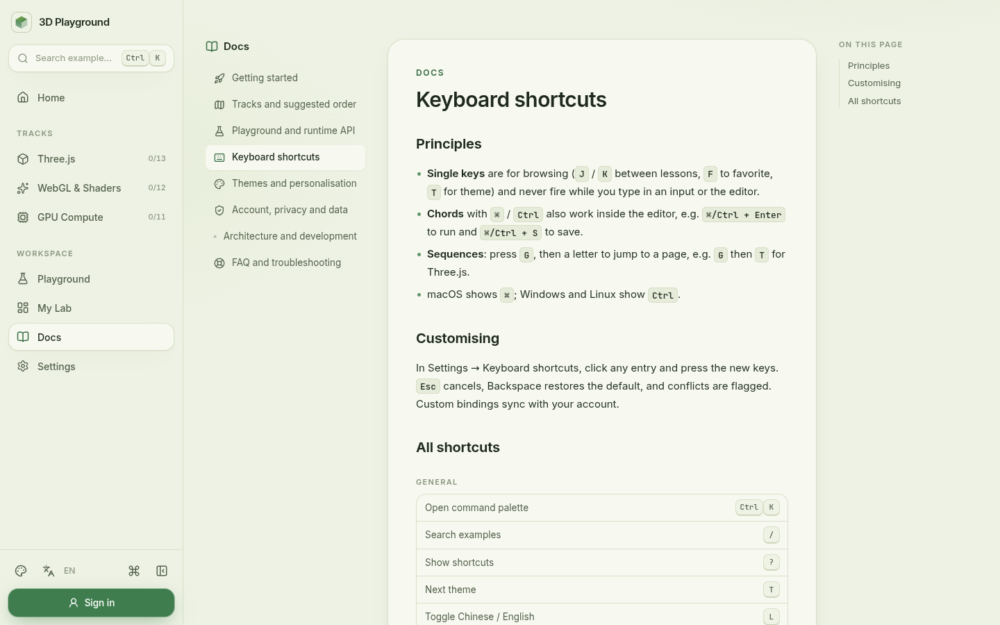

<div align="center">

# 3D Playground

**把 GPU 变成你的画布 · Turn the GPU into your canvas**

在浏览器里边读、边改、边看：Three.js、WebGL 着色器、GPU / WebGPU 计算，36 节可实时运行的中英双语课程。

[**▶ 立即在线体验 / Try it live**](https://3d-playground-ji.vercel.app) &nbsp;·&nbsp; [中文](#中文) &nbsp;·&nbsp; [English](#english)




</div>

---

## 中文

### 为什么是 3D Playground？

学图形学最难的不是公式，而是 **“看不见”**：改了一行着色器，不知道它到底改变了什么；读懂了渲染管线，却没地方动手试。

3D Playground 把三样东西放在同一屏：**讲清原理的文章**、**可以直接改的代码**、**立刻刷新的实时画面**。不用装任何东西，不用配环境，打开浏览器就能从第一个三角形一路走到光线步进、GPU 粒子和计算着色器。

| 你是… | 你能得到 |
| --- | --- |
| 前端工程师，想入门 3D | 从「场景 · 相机 · 渲染器」开始，13 节 Three.js 课程覆盖日常项目 90% 的需求 |
| 想真正搞懂着色器的人 | 不靠黑盒，亲手写 MVP 矩阵、光照、噪声、光线步进，12 节 WebGL / GLSL |
| 对 GPU 计算好奇的人 | 从「CPU vs GPU」讲到 WebGPU 计算管线、GPGPU、性能分析，11 节 |
| 老师 / 技术分享者 | 每节都有可交互参数面板，现场拖滑块就能讲明白一个概念 |
| 团队 / 个人实验者 | Playground 一键起手 Three.js / WebGL 2 / WebGPU，代码片段云端保存 |

### 三条学习路径 · 36 节可运行课程

每节课都包含：中英双语概念文章 · 核心 API 速查 · 练习题 · 可编辑源码 · 实时预览 · 参数面板。

<table>
<tr>
<th>Three.js 核心（13）</th>
<th>WebGL 与着色器（12）</th>
<th>GPU 与 WebGPU 计算（11）</th>
</tr>
<tr valign="top">
<td>

1. 场景 · 相机 · 渲染器
2. 几何体与 BufferGeometry
3. 材质大比拼
4. 灯光与阴影
5. 纹理与 UV
6. 场景图与变换
7. 动画：缓动与关键帧
8. 射线拾取
9. 实例化渲染
10. 后期处理
11. PBR 与环境光照
12. 粒子：Points 星系
13. 相机：透视、正交与视锥

</td>
<td>

1. GPU 渲染管线 · Hello Triangle
2. Attribute 与 Varying
3. Uniform：让着色器动起来
4. MVP 矩阵：亲手搭建 3D
5. 纹理与采样：过滤、环绕、Mipmap
6. 片元着色器艺术：SDF 与调色板
7. 噪声与 fBm：程序化云和大理石
8. 光线步进：用距离场画 3D
9. three.js ShaderMaterial
10. 帧缓冲与后期处理
11. 手写光照：Lambert、Phong、Fresnel
12. 着色器调试：用颜色“打印”数值

</td>
<td>

1. CPU 与 GPU：并行的力量
2. 你好 WebGPU：第一个三角形
3. 缓冲区与绑定组
4. 计算着色器入门
5. GPU 粒子：计算 + 实例化
6. GPU 上的生命游戏
7. WebGL2 上的 GPGPU：水波模拟
8. 绘制调用与实例化
9. three.js WebGPURenderer 与 TSL
10. 计算着色器做图像处理
11. GPU 性能：时间花在哪里

</td>
</tr>
</table>

| WebGL · 噪声与 fBm | GPU · GPGPU 水波模拟 |
| --- | --- |
|  |  |
| **Three.js · PBR 与环境光照** | **Playground · 自由实验** |
|  |  |

### 功能与价值

#### 🧪 学习工作台：读 → 改 → 看，零切换
- **CodeMirror 6 编辑器**：语法高亮、自动补全、搜索替换、字号调节。
- **隔离沙箱实时预览**：代码在独立 iframe 中运行，崩溃不影响页面；显示 FPS、运行状态，支持暂停、重置、保存、全屏。
- **控制台**：错误与日志计数，一眼定位问题。
- **布局随心**：左右分栏可拖动，或上下堆叠；自动运行、本地草稿自动保存。
- **参数面板**：每节课都暴露关键参数，拖动滑块即刻看到效果变化——这是理解图形学最快的方式。

#### 🚀 Playground：从模板到作品
- 内置 **Three.js 场景 / WebGL 2 全屏着色器 / WebGPU 三角形** 三个起手模板。
- 任何实验都能保存为 **代码片段**，登录后跨设备同步。
- 极简运行时 API：`PG.canvas` 拿到画布，`PG.status(text)` 在画面上显示状态。

#### 🔐 账号与数据：你的进度只属于你
- 注册 / 登录，**bcrypt** 密码哈希，**JWT HttpOnly + SameSite Cookie**，连续登录失败临时锁定。
- **严格的用户数据隔离**：进度、收藏、代码片段、设置均按用户隔离，并有自动化测试与线上冒烟测试守护。
- **访客模式**：不注册也能完整使用（数据存在本地），首次登录时**自动合并**到账号。
- 修改密码、**JSON 导入/导出**、一键删除账户——数据完全可控。

#### 🎨 9 套精致主题 + 跟随系统
浅色 · 深色 · 护眼 · 黑红 · 黑金 · 星云紫 · 深海 · 樱花 · 石墨。每套主题都经过对比度测试，代码高亮、阴影、渐变、玻璃质感随主题联动。



#### ⌨️ 30 个快捷键，键盘党友好
- `⌘/Ctrl K` 命令面板，`/` 搜索课程，`?` 查看全部快捷键。
- `G` 序列导航：`G T` Three.js、`G W` WebGL、`G G` GPU、`G P` Playground……
- `J / K` 上下课、`F` 收藏、`C` 标记完成、`⌘/Ctrl Enter` 运行、`⌘/Ctrl S` 保存、`P` 暂停。
- **全部可自定义**，并自动检测冲突；macOS 显示 `⌘`，Windows/Linux 显示 `Ctrl`。

#### 🌏 完整中英双语
界面、课程、文档全部中英双语，`L` 一键切换。测试保证两种语言 key 完全一致，并禁止组件中硬编码文案。

#### 📚 8 篇内置文档
快速开始 · 学习路径 · Playground 与运行时 API · 快捷键 · 主题 · 账号隐私与数据 · 架构与开发 · FAQ。



### 亮点

- ✨ **真·可运行**：36 节课全部在 headless Chromium（SwiftShader 软件渲染）里自动跑过，零 console error。
- 🧠 **讲原理，不只给代码**：例如讲清 `workgroup_id * WG + local_invocation_index` 与 `global_invocation_id` 的等价、`onSubmittedWorkDone` 如何控制 in-flight 帧、为什么 GPGPU 要 ping-pong 两张纹理。
- 🛟 **稳健降级**：WebGPU 不可用时给出清晰提示；TSL 课程自动回退到 WebGL2；着色器避开软件渲染器会崩溃的写法。
- 🧩 **可维护、可复用**：纯逻辑集中在 `src/core` 并全部单测覆盖；服务端处理器是框架无关的 `Request → Response`；一节课 = 一个文件夹，新增课程无需改任何页面代码。
- ✅ **TDD**：12 个测试文件、327 个测试，覆盖主题、快捷键、i18n、课程元数据、API 与用户隔离（PGlite 内存 Postgres）。
- 📱 **响应式**：桌面侧栏 + 移动端抽屉，尊重系统「减少动态效果」设置。
- ⚡ **推送即上线**：Vercel 自动部署，Neon Serverless Postgres。

### 浏览器支持

Three.js 与 WebGL 课程支持所有现代浏览器。WebGPU 课程需要 **Chrome / Edge 113+** 或 **Safari 26+**；不支持时会提示，部分课程自动回退 WebGL2。

---

## English

### Why 3D Playground?

The hardest part of learning graphics isn't the math, it's that **you can't see it**. 3D Playground puts three things on one screen: **an article that explains the idea**, **code you can edit**, and **a live result that updates instantly**. Nothing to install: go from your first triangle to raymarching, GPU particles and compute shaders in the browser.

### Three tracks, 36 runnable lessons

- **Three.js essentials (13)**: scene/camera/renderer, BufferGeometry, materials, lights & shadows, textures, scene graph, animation, raycasting, instancing, post-processing, PBR & IBL, particles, cameras & frustum.
- **WebGL & shaders (12)**: the pipeline, attributes/varyings, uniforms, MVP by hand, sampling & mipmaps, SDF art, noise & fBm, raymarching, ShaderMaterial, framebuffers, GLSL lighting, shader debugging.
- **GPU & WebGPU compute (11)**: CPU vs GPU parallelism, hello WebGPU, buffers & bind groups, compute basics, compute particles, Game of Life, GPGPU on WebGL2, draw calls & instancing, WebGPURenderer & TSL, image compute, GPU performance.

Every lesson ships a bilingual concept article, core API notes, exercises, editable source, a live preview and a parameter panel.

### Features

- **Workbench**: CodeMirror 6, sandboxed iframe preview (FPS, pause, reset, save, fullscreen), console with error counts, resizable split or stacked layout, auto-run, local drafts.
- **Playground** with Three.js / WebGL 2 / WebGPU templates; save any experiment as a snippet. Runtime API: `PG.canvas`, `PG.status(text)`.
- **Accounts with strict per-user isolation**: bcrypt, HttpOnly SameSite JWT cookie, lockout on repeated failures; guest mode in localStorage merged on first sign-in; password change, JSON export/import, account deletion.
- **9 themes** (light, dark, eye care, black-red, black-gold, nebula purple, deep ocean, sakura, graphite) + follow system, contrast-tested.
- **30 keyboard shortcuts**: command palette (`⌘/Ctrl K`), `G`-sequences, `J`/`K` between lessons, fully customisable with conflict detection.
- **Full zh/en i18n**, toggled with `L`; tests keep both dictionaries in sync.
- **8 in-app docs**: getting started, tracks, runtime API, shortcuts, themes, privacy, architecture, FAQ.

### Highlights

- Every lesson is verified headless (Chromium + SwiftShader) with zero console errors.
- Explains the *why*: thread indexing, in-flight frames, ping-pong textures, tone mapping and more.
- Graceful fallbacks when WebGPU isn't available.
- 327 tests across 12 files; pure logic in `src/core`, framework-agnostic `Request → Response` handlers; one lesson = one folder.
- Push to `main` deploys on Vercel; Neon serverless Postgres.

---

## 开发 · Development

```bash
npm install
npm run dev          # 先 vendor three.js 并打包课程 / vendors three.js and bundles lessons first
npm test             # Vitest：核心逻辑、i18n、主题、快捷键、课程、API 与隔离（PGlite）
npm run lint         # ESLint + tsc --noEmit
```

环境变量 / Environment: `DATABASE_URL`（Neon / Postgres）与 `JWT_SECRET`。本地可通过 `NEON_FETCH_ENDPOINT` 把 Neon HTTP 驱动指向 PGlite shim。

### 目录结构 · Layout

| Path | What |
| --- | --- |
| `src/core` | 纯逻辑，全部单测：主题、快捷键、i18n、Markdown、高亮、搜索、用户数据 schema、控制台模型 |
| `src/server` | Postgres 访问、鉴权、框架无关的 `Request → Response` 处理器 |
| `src/client` | 数据源抽象（访客 / 账号）、应用状态、快捷键分发 |
| `src/components` | 设计系统基础组件（`ui.tsx`）与页面 |
| `src/content` | 文档与 Playground 模板 |
| `examples/<track>/<slug>` | 一节课一个文件夹：`meta.json` + `main.js`（规范见 `docs/AUTHORING-EXAMPLES.md`） |
| `public/sandbox.html` | 课程运行的 iframe 沙箱 |
| `scripts/` | vendor、课程打包、开发服务器、headless 课程检查 |

### 新增一节课 · Add a lesson

1. 在 `examples/<three|webgl|gpu>/` 下新建文件夹，写 `meta.json`（中英标题、摘要、文章、API、练习）和 `main.js`。
2. `npm test` 校验元数据与双语完整性；`python3 scripts/check_example.py <track>/<slug>` 用 headless 浏览器跑一遍并截图。
3. 推送 `main`，Vercel 自动上线。

---

<div align="center">

**[打开 3D Playground →](https://3d-playground-ji.vercel.app)**

如果它帮你看懂了 GPU，欢迎点一个 ⭐ · If it helped the GPU click for you, a ⭐ is appreciated.

</div>
